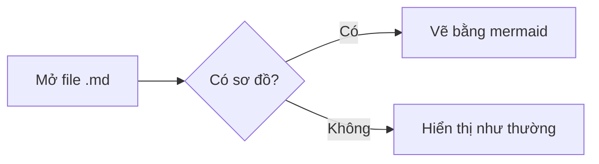
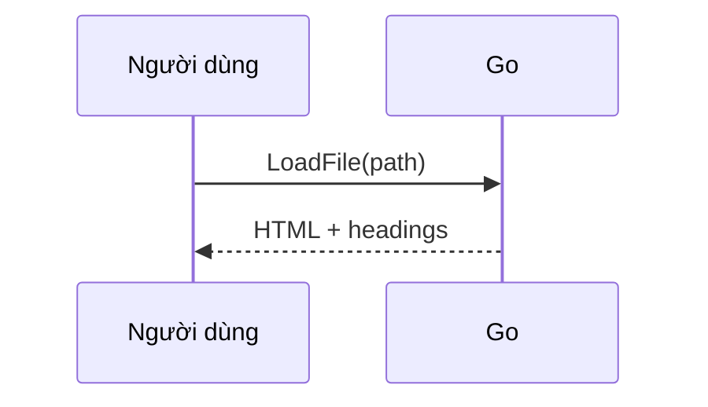

# Phase 4: sơ đồ, công thức, code

## Mermaid





Sơ đồ lỗi:

```mermaid
graph TD
  A --> 
```

## Công thức

Inline: năng lượng $E = mc^2$, chỉ số $a_1 * b_2$, giá $5 và $10 không phải công thức.

$$
\int_0^\infty e^{-x^2}\,dx = \frac{\sqrt{\pi}}{2}
$$

```math
\begin{pmatrix} a & b \\ c & d \end{pmatrix}
```

## Code

```go
func main() {
	fmt.Println("Xin chào")
}
```
